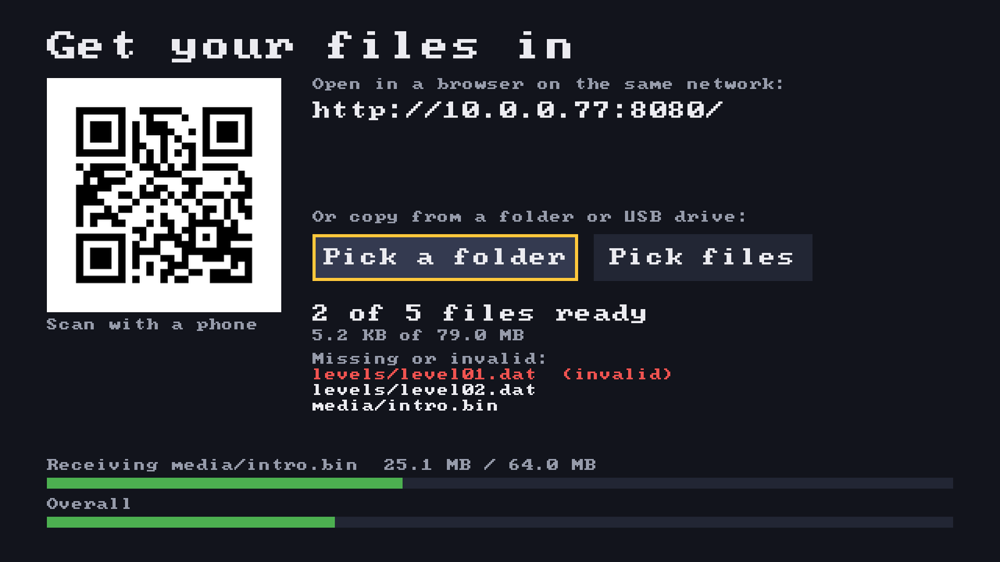
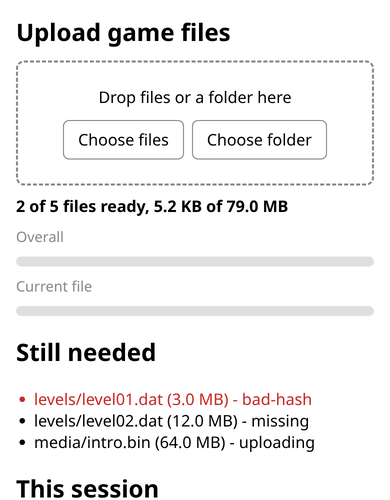
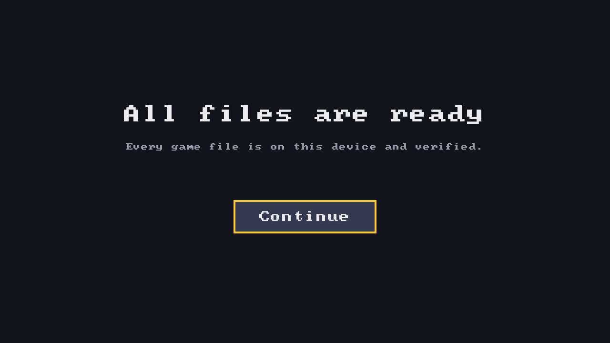

# SDL UWP onboarding example

- A small UWP app for Xbox One/Series in Developer Mode and Windows 10/11 that asks the user for game files you cannot ship.
- Users upload the files from any browser on the LAN (scan a QR code on the TV), or pick a folder or files on the device.
- Every file is checked against a SHA-256 manifest built into the app. Broken or partial files never reach their final location.
- Built with [SDL3-uwp](https://github.com/XboxEmulationHub/SDL3-uwp), C++/WinRT and [nayuki's QR code generator](https://github.com/nayuki/QR-Code-generator). Builds and packages on Linux.

<table>
  <tr>
    <td></td>
    <td></td>
  </tr>
  <tr>
    <td>On the TV: QR code, upload progress and a file rejected for a bad hash.</td>
    <td>On the phone: the upload page.</td>
  </tr>
  <tr>
    <td colspan="2"><br>Once every file is verified.</td>
  </tr>
</table>

## Using the app

On first start the app checks which files are already there, then shows **Get your files in**:

- Scan the QR code with a phone, or open the URL shown under it in a browser on the same network. Drop the files or their folder on the page, or use its file and folder buttons. The page and the TV both show progress.
- Or press **Pick a folder** (or **Pick files**) and choose a folder or files on the device or a USB drive. On Xbox these buttons are enabled only while a USB drive is connected.

The page is plain `http://`. If a phone browser upgrades the address to `https://` and shows an error or a warning, type `http://` explicitly or continue to the insecure page. The console has no certificate a phone would trust.

Files that do not match the manifest are rejected and listed as invalid. Upload or copy the right file again to fix it. When every file is verified, **Continue** takes you to the app.

Later starts only hash files that changed since they were last verified, so they reach the **Continue** screen quickly.

Controls: D-pad or left stick moves the focus, A selects. On PC, arrow keys or Tab move the focus, Enter or Space selects, and the mouse works too.

## Deploying to an Xbox

You need a console in [Developer Mode](https://learn.microsoft.com/windows/uwp/xbox-apps/devkit-activation) with Device Portal enabled. Install the app together with the VC++ runtime package it depends on:

```sh
tools/deploy.sh https://<console-ip>:11443 build/package/onboarding.appx \
  build/package/Microsoft.VCLibs.x64.14.00.appx
```

The script uploads both packages, waits for the install and starts the app. Set `WDP_USER` and `WDP_PASSWORD` if your portal asks for credentials. You can also install through the Device Portal web page (Home, Add, then add the VCLibs package as a dependency).

In Dev Home, set the app type to **Game** if you want it to have more memory. A plain onboarding app is fine as **App**.

## Testing on Windows

Install the certificate from `~/.local/share/sdl-uwp-onboarding-cert/test-cert.cer` into "Trusted People" of the local machine, then install the VCLibs package and `onboarding.appx` by double-clicking them, or with `Add-AppxPackage`.

Windows blocks a UWP app from receiving connections from the same PC. Open the upload page from another device, or allow loopback while testing:

```bat
CheckNetIsolation.exe LoopbackExempt -is -n=SdlUwpOnboarding_<publisher-hash>
```

The command keeps running while the exemption is active. The package family name is shown by `Get-AppxPackage SdlUwpOnboarding`.

To get test files, run `python3 tools/make_testdata.py --bad build/testdata-bad`. It writes the five files from the manifest to `testdata/` (one is 64 MB, so progress is visible) and corrupted copies to `build/testdata-bad/` for testing rejection. The content is generated, so the files are not stored in git.

## Using your own files

Put your files in one folder and write the manifest from it:

```sh
python3 tools/make_manifest.py /path/to/gamefiles -o assets/manifest.txt
```

Each line is `<sha256-hex> <size-bytes> <relative/path>`. Rebuild afterwards. The build turns `assets/manifest.txt` into a header, so the app always carries the manifest it was built with. Files end up in `LocalState/gamedata/<relative/path>`.

## Xbox and desktop differences

- **Network:** on the console the app listens on all network adapters and shows every LAN IPv4 address. On a PC the loopback restriction above applies.
- **Pickers:** on Xbox the picker buttons are enabled only while a removable drive is connected. An external game drive counts as one too. The Xbox folder and file pickers are basic and only show some locations, such as USB drives. If a picker shows nothing useful, use the browser upload instead.
- **Broad file system access:** the manifest asks for `broadFileSystemAccess`. That is accepted for sideloaded apps and Dev Mode but needs approval in the Microsoft Store. The pickers grant access to what the user chooses either way.
- **Controller:** on the console the B button may be handled by the system. The app only uses the D-pad, left stick and A.
- **Screen:** the UI is drawn at 1280x720 and scaled to the screen with letterboxing, so it stays inside the TV safe area on most TVs.

## Known limitations

- The upload server speaks plain HTTP with one request per connection. Anyone on the same network can open the page while the app runs, but it only accepts files whose size and hash match the manifest.
- Two uploads run at a time. An upload that stops sending is dropped after 30 seconds without data, and one that is very slow is dropped once it falls below about 32 KB/s on average. Either can be retried.
- Files are matched by path, and as a fallback by a unique trailing path or file name. Two manifest files with the same name in different folders need their folder in the upload.
- The verification cache trusts a file's size and modification time. A file changed in place without a new modification time is not detected until the cache file `LocalState/gamedata/.verified` is deleted.
- Text uses SDL's built-in 8x8 font, which covers ASCII only.

## Building

The app builds on Linux with clang-cl and lld-link for the app, and MSVC under Wine for SDL3-uwp, because its WinRT code is C++/CX and only MSVC compiles that.

You need:

- [msvc-wine](https://github.com/mstorsjo/msvc-wine) with MSVC 14.51 and Windows SDK 10.0.26100, in `~/.local/share/msvc`, and .NET Framework 4.8 in its Wine prefix (C++/CX needs it).
- C++/WinRT headers from an [xwin](https://github.com/Jake-Shadle/xwin) splat in `~/.cache/cargo-xwin/xwin`. msvc-wine stores them in lower case only.
- clang, clang-cl and lld 18 or later, CMake 3.25, Ninja, Python 3.
- [makemsix](https://github.com/microsoft/msix-packaging) built with `-DMSIX_PACK=on`, [osslsigncode](https://github.com/mtrojnar/osslsigncode), OpenSSL and ImageMagick for packaging.
- `Microsoft.VCLibs.x64.14.00.appx` from the MSVC installer (`Microsoft.VisualCpp.CRT.Appx.Msi`).

The paths can be changed with `MSVC_ROOT`, `XWIN_ROOT`, `MSVC_VERSION` and `WINSDK_VERSION`.

```sh
git submodule update --init
tools/build_sdl3.sh
cmake -S . -B build/app -G Ninja -DCMAKE_BUILD_TYPE=Release \
  -DCMAKE_TOOLCHAIN_FILE=cmake/clang-cl-toolchain.cmake
cmake --build build/app
MAKEMSIX=/path/to/makemsix VCLIBS_APPX=/path/to/Microsoft.VCLibs.x64.14.00.appx \
  tools/package.sh build/app build/package
```

`tools/build_sdl3.sh` applies the patches in `patches/sdl3-uwp` to a separate worktree of the submodule and installs SDL into `build/sdl3-prefix`. One patch sets the thread ID in SDL's C++ thread backend, which fixes a deadlock when audio starts. The other replaces a pixel format helper the WinRT video driver could not build with. Both are meant to go upstream.

`tools/package.sh` creates a test signing certificate on first use and reuses it, so a device only has to trust it once. Pass `CERT_PFX` to sign with your own certificate. Its subject must equal the `Publisher` in `packaging/AppxManifest.xml`.

The code is split into `src/manifest` (manifest parsing and matching), `src/storage` (checking, writing, the verification cache and picker imports), `src/net` (the HTTP server and the upload page in `web/index.html`) and `src/ui` (drawing and focus), with the screens in `src/app.cpp`.

## License

MIT, see [LICENSE](LICENSE). SDL3-uwp is under the zlib license and the QR code generator under MIT.
